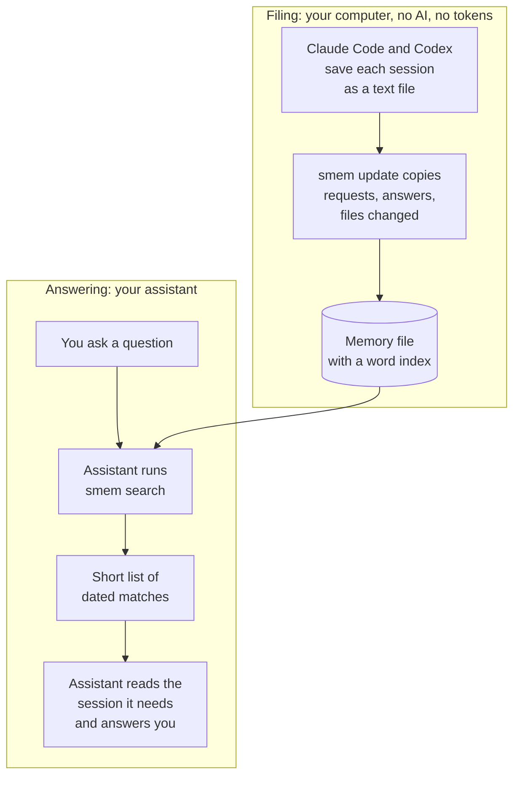

# Session Memory

Claude Code and Codex start each new session without your earlier ones. smem gives both one shared memory of every past session (what you asked, what they answered, which files changed, when) and a skill to search it, so they look things up instead of asking you. Runs on your computer, and keeps sessions past Claude Code's 30-day deletion.

## Without smem, and with it

| | Without smem | With smem |
| --- | --- | --- |
| **A new session** | The assistant starts without your earlier sessions, so you explain again what happened. | The assistant looks up what happened and tells you. |
| **Finding one old decision** | Not knowing which session holds it, the assistant would have to read through old logs. A typical session is tens to hundreds of thousands of tokens, a long one millions, and the whole history here about 12 billion. In practice it can't, so it asks you. | One search across every session takes under a tenth of a second and returns a short list of dated matches: a few hundred to about 1,300 tokens in the searches measured. The assistant then opens only the session it needs. |
| **Claude Code and Codex** | Each sees only its own sessions. | Each finds the other's work too. |
| **Claude Code sessions older than 30 days** | Deleted by Claude Code's default cleanup, for good. | Kept in the memory once smem has read them, and still searchable, unless you choose otherwise. |
| **The whole history** | About 46 GB of raw logs (21.5 GB on disk, since Codex keeps older ones compressed). | A 0.74 GB memory file, holding 184 MB of text. |
| **Keeping it up to date** | There's nothing to search, so nothing to update. | An ordinary program copies the text of the logs that changed. No AI model is involved, so it uses no tokens. It takes a few seconds. |
| **A forgotten name** ("that tool we built that could…") | The assistant has no way to find it without you. | It searches for words describing what the tool did and finds the session where it was built. Search matches words, not meaning, so it may try a few. |
| **Work split across parallel sessions** | Spread over separate logs, one per session or helper. | All in one place, with helper sessions linked to the sessions that started them. |
| **Privacy** | | Nothing leaves your computer: no network, no account. The memory is readable only by you, and common secrets are redacted before storing. |

*Numbers from one real history of 6,575 sessions on a Mac; yours will differ. Tokens are estimated at about 4 characters each.*

## Why it isn't magic

1. **The record already exists.** Claude Code and Codex already save every session as a text file on your computer. smem records nothing new.
2. **An ordinary program copies the useful parts.** It reads those files and copies your requests, the answers and the files changed into one SQLite database, the kind built into phones and web browsers.
3. **A word index makes search instant.** Like the index at the back of a book, it lists for each word the sessions that contain it. Looking a word up is bookkeeping, not AI, so a search costs no tokens.
4. **The AI only reads the short results.** Your assistant runs a search, reads the dated matches, then opens one session, one turn, or runs its own query over the whole record, as the question needs. Then it answers you.

Your computer does the filing; your assistant does the reading and thinking.



## Ask the way you'd ask a colleague

- "What was that tool we built that could do X? I forget the name."
- "What have we worked on over the last ten days: projects, progress, what's unfinished?"
- "Remind me what we got done yesterday, what's still open, and what we planned but haven't decided."
- "Did we already try this? What happened?"
- "What did Codex do on this project while I was in Claude Code?"

Your assistant turns the question into searches, reads the sessions that match, and answers in its own words. smem provides the record; your assistant does the summarizing. Search matches words, not meaning, so for something whose name you've forgotten the assistant tries a few describing words. That usually finds it, but not always.

## Install

Paste this into Claude Code or Codex:

> Install Session Memory for me by following https://github.com/Palis8d/session-memory/blob/main/AGENT_INSTALL.md

Your assistant checks your computer, asks you before changing anything, installs it, and shows you that it works.

Or, in a terminal:

```bash
curl -fsSL https://raw.githubusercontent.com/Palis8d/session-memory/main/install.sh | sh
```

To check first: read [install.sh](install.sh) (49 lines), or install and run `smem setup --dry-run` to see every change before it's made.

*If you are an AI assistant, follow [AGENT_INSTALL.md](AGENT_INSTALL.md).*

## What else you get

- **Skills, so they just use it.** Each assistant learns how to search the memory; you don't explain anything.
- **You stay in control.** Exclude folders, forget any session, preview every change, and refresh automatically, on demand, or never.
- **It checks itself.** Health checks flag log-format changes and missing logs, and tests break each key safety rule on purpose to prove they'd notice.
- **Installed by your assistant.** Paste one sentence; it asks before changing anything and verifies that it works.

## Verify it yourself

```bash
smem health --selftest      # the checks catch 5 kinds of breakage in built-in samples, and stay quiet in 2 normal ones
smem setup --dry-run        # every change setup would make, without making it
```

And in a copy of this repository, this prints nothing, because no file imports a network library:

```bash
grep -rnE "^\s*(import|from)\s+(socket|ssl|http|urllib\.request|urllib3|requests|httpx|aiohttp|ftplib|smtplib|xmlrpc|websocket)" src/
```

The only other programs smem starts are `launchctl` or `systemctl` (for auto refresh) and `zstd` (to read compressed Codex logs, when Python can't).

## How it was tested before release

- **A fresh install by an AI agent** that knew nothing about the project, in a clean throwaway home, following only this README and [AGENT_INSTALL.md](AGENT_INSTALL.md). It then used smem to answer questions about sample history.
- **Two separate AI reviews**, one for correctness and one for privacy and security. Each finding was reproduced before it was fixed.
- **Secret redaction** is tested against 124 realistic fake secrets, and 87 ordinary snippets that must stay unchanged.
- **Every key safety rule broken on purpose**, one at a time, to confirm a test notices. All 21 breaks are caught; rerun them with `python3 -I tests/break_on_purpose.py` (a few minutes).
- **A real history of more than 6,000 Claude Code and Codex sessions**, read-only, into a throwaway folder.
- **68 automated tests** on Python 3.11 to 3.14. In daily use, `smem health` checks that the memory is current, that every log on disk is in it, that counts match Codex's own index, and that the log formats haven't changed; `--selftest` shows those checks catching five kinds of breakage (four log-format changes, and logs vanishing from disk) and staying quiet in two normal situations.

[SECURITY.md](SECURITY.md) lists each safety promise with the test that proves it, and what smem does and doesn't protect against.

## Use it

Ask your assistant in your own words. Or run it yourself:

```bash
smem search "login page"      # words from any request or answer
smem recent                   # what you worked on in the last few days
smem session 7f3a             # one session, by id or name
smem files config.toml        # which sessions changed a file
smem project myapp            # one project's sessions
```

`smem --help` lists every command.

## Keeping sessions after their logs are deleted

A log can disappear for three reasons: the assistant's own cleanup (Claude Code deletes logs after 30 days by default, its `cleanupPeriodDays` setting; Codex never cleans up on its own), you deleting a session yourself (both apps let you), or a change in an app's cleanup rule.

smem tells these apart as well as it can: a Claude Code log older than its cleanup period looks like the cleanup; a younger one, or any Codex log, looks deleted by hand. You choose what the memory does:

- **all** (the default): keep every session, so nothing is lost by accident.
- **auto**: keep sessions the assistants' own cleanup removed, and forget the ones you deleted yourself.
- **main**: keep main sessions and forget the helper sessions they started, for the leanest memory.
- **none**: forget deleted sessions too, so the memory mirrors what's on disk.

Set it with `smem settings retention.keep all|auto|main|none`. Keeping costs little: the memory stores only requests and answers, so on one real history the memory file is about a sixtieth of the raw logs' size. `smem forget ID` erases any one session (and the helpers it started) for good, and `smem forget --deleted` erases every kept session that looks deleted by hand.

`smem health` reports what happened: how many logs each assistant's cleanup took, how many look deleted by hand, and a warning when many younger logs vanish in one update, which suggests an app changed its cleanup rule. To keep Claude Code's full original logs as well, raise `cleanupPeriodDays` in `~/.claude/settings.json`.

## Keeping it current

Updating the memory uses no AI and no tokens. It's your computer reading log files, and it reads only the ones that changed since last time.

- **Auto** (every 15 minutes): the memory is always ready, and answers come instantly.
- **Manual**: nothing runs in the background. When results are out of date, they end with a plain note, for example "Since then 2 Claude Code sessions changed." The assistant can then update first, which takes seconds. Claude Code may do this without asking you; in Codex, its sandbox setting decides whether it asks.
- **Off**: nothing updates. Search still works on what's stored.

## Your data stays yours

- It only reads your Claude Code and Codex history and never changes it. The one thing it adds in `~/.claude` is its skill (`~/.claude/skills/smem`); Codex's skill goes in `~/.agents/skills/smem`.
- The memory is one SQLite file in `~/.local/share/session-memory/`, readable only by your account. No network, no account, no telemetry. It grows with your history, roughly 120 KB per session.
- Common forms of passwords, keys and tokens are replaced with `[REDACTED]` before anything is stored. This is best effort: a secret in an unusual format can get through.
- To keep folders out: `smem settings privacy.exclude_paths '["~/clients/acme"]'`. This sets the whole list (`smem settings privacy.exclude_paths` shows it). The next update removes those sessions and erases their text from the file.
- When an assistant reads results, they go to that assistant's provider like anything else it reads. For example, Claude Code sessions that Codex looks up are sent to OpenAI.
- `smem forget ID` erases a session from the memory for good; updates won't read it back (`--undo` reverses that).
- `smem uninstall` lists, then removes, its skills, background job, settings and memory. Your Claude Code and Codex history is never touched. The program itself goes with `uv tool uninstall session-memory` (or `pipx uninstall session-memory`).

## Control

- **Settings:** one file, `~/.config/session-memory/config.toml`. `smem settings` shows it; `smem settings KEY VALUE` changes one value. You can also edit the file by hand, but `smem` rewrites it on changes, so comments you add aren't kept.
- **Refresh:** `smem refresh auto|manual|off --every 30`. Auto refresh is a standard background job: launchd on macOS, a systemd user timer on Linux. `smem refresh --show` prints it. On macOS, turning it on shows a "Background Items Added" notice naming Python; that's this job. On Linux the timer runs while you're logged in.
- **Skills:** `smem skills`. It never overwrites a skill it didn't create, and upgrades leave a skill you edited alone.
- **Previews:** `setup`, `refresh`, `settings`, `skills`, `forget` and `uninstall` take `--dry-run`.
- **Your own queries:** `smem sql` runs read-only SQL (it can't write anything), and `smem schema` explains the tables.

## Requirements and limits

- macOS or Linux, with [uv](https://docs.astral.sh/uv/) or pipx. uv fetches Python 3.11+ if you don't have it. Windows hasn't been tested, and auto refresh isn't available there.
- Only sessions whose logs are or were on this computer are included. A session deleted before you install smem can't be recovered.
- Not stored: hidden reasoning, command output and tool results, images. Commands are counted, not kept.
- Search matches words and their endings, not meaning.
- Some Linux systems have an unrelated memory-reporting tool also called `smem`. If yours does, the one found first on your PATH runs.

## License

MIT
